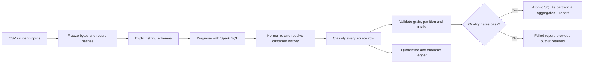

# ETL Pipeline Recovery

**Pipeline Rescue** is a working incident lab for the service **“Fix Broken ETL Pipelines.”** It reproduces defective Spark queries, profiles their causes, and validates a corrected partition before publishing it.

**Python · PySpark 4.3 · Spark SQL · SQLite · pytest**

Independent portfolio project by **Henrique Ramos**. The incident and commerce records are authored synthetic data; the Spark execution, exceptions, SQL transactions and validation results are real.

[Português](README.pt-BR.md) · [Incident report](docs/INCIDENT_REPORT.md) · [Data contract](docs/DATA_CONTRACT.md) · [Runbook](docs/RUNBOOK.md) · [Verification](docs/VERIFICATION.md) · [Fiverr portfolio copy](docs/FIVERR_PORTFOLIO.md)

## The recovery case

| Failure | Observable evidence | Correction |
| --- | --- | --- |
| Schema drift | Legacy SQL raises `UNRESOLVED_COLUMN.WITH_SUGGESTION` | Explicit aliases for `price → unit_price` and `ordered_at → order_date`; reject ambiguous schemas |
| Unsafe casts | ANSI decimal cast raises `CAST_INVALID_INPUT` | Contract-based formatting, `try_cast`, validation and quarantine |
| Historical join fan-out | 17 source rows produce 25 legacy join rows | Resolve one current customer per key before joining |
| Append replay | A second defective run grows the isolated legacy target to 50 rows | Transactional partition publication and content-based replay detection |
| Invalid/conflicting source versions | A row ledger retains eight rejected records with reason codes | Quarantine the affected keys; do not resurrect an older value |

The legacy target is deliberately isolated from curated output. Running a broken scenario does not corrupt the corrected table.

## Observed recovery

Verified on **20 November 2026**, with the bundled 18 November partition:

```text
17 source records
 = 7 accepted lines
 + 8 quarantined records
 + 1 exact duplicate
 + 1 superseded version

7 accepted lines → 6 demo orders → BRL 511.20 gross fixture value
Replay → unchanged published partition
Strict zero-quarantine gate → blocked, previous partition preserved
```

Eight gates pass on normal recovery: frozen-source row count, source conservation, nonempty output, unique business keys, explicit partition scope, Spark amount reconciliation, full outcome accounting and SQLite target reconciliation. The optional ninth gate requires zero quarantine and intentionally blocks this fixture.

The expected result is [hand-authored independently](recovery/fixtures/expected.json), and is used by tests and the verification script. **The recovery engine never reads the expected-results file.**

Inspect the [evidence manifest](docs/evidence/manifest.json), [recovery report](docs/evidence/recovered/report.json), [replay](docs/evidence/replay/report.json), and [blocked strict run](docs/evidence/strict-blocked/report.json). These are actual saved executions, not sample success responses.

## Run locally

Requirements: **Python 3.11+**, **Java 17+**, and `JAVA_HOME` pointing to a working JDK. PySpark contains a large Spark distribution; the first dependency installation can take several minutes. No paid service, external cluster, LLM or API key is required. See the official [PySpark installation documentation](https://spark.apache.org/docs/4.3.0/api/python/getting_started/install.html).

```powershell
git clone https://github.com/Henrxque/etl-pipeline-recovery.git
cd etl-pipeline-recovery
python -m venv .venv
.venv/Scripts/python -m pip install -r requirements.lock
.venv/Scripts/python -m pip install --no-deps -e .
# If Java is not already configured:
$env:JAVA_HOME = 'C:/path/to/your/jdk-17'
.venv/Scripts/python -m uvicorn recovery.main:app --host 127.0.0.1 --port 8002
```

On Linux/macOS use `.venv/bin/python` and configure `JAVA_HOME` for that machine. Open **http://127.0.0.1:8002/**. The server starts without Spark and initializes its JVM when the first action runs. Cold startup may take tens of seconds.

The local setup used a checksum-verified official [Eclipse Temurin 17](https://github.com/adoptium/temurin17-binaries/releases) portable JDK inside ignored `.tools/`; no global Java setting was changed. The optional ignored `.tools/java-home.txt` points at that local JDK. It is a local convenience, not a Java distribution shipped in this repository.

### Demonstrate the workflow

1. **Reproduce failure:** select schema, cast or historical join. Inspect the actual failed run.
2. **Diagnose input:** inspect source column aliases, unsafe direct-cast rows, repeated line keys and customer-history cardinality.
3. **Recover partition:** inspect accepted/rejected outcomes and passed gates. Only validated output is published.
4. **Recover again:** confirm the publication action is **Unchanged**.
5. Enable **Require zero quarantined rows**, then recover again: the job fails its strict gate and keeps the previously published output.
6. Download the persisted report JSON, row outcomes CSV and execution logs.

This is a small local monitor, not a hosted SaaS. The server must stay running to execute a job. The browser-control service was unavailable during this session; the API actions/downloads were exercised directly, while interactive visual/responsive QA remains unverified. See [verification boundaries](docs/VERIFICATION.md).

## CLI and reproducible evidence

Put the optional global `--database` flag **before** the command:

```powershell
# Broken scenarios intentionally exit with code 1.
.venv/Scripts/python -m recovery.cli --database tmp/demo.sqlite3 broken --scenario schema
.venv/Scripts/python -m recovery.cli --database tmp/demo.sqlite3 broken --scenario cast
.venv/Scripts/python -m recovery.cli --database tmp/demo.sqlite3 broken --scenario join
.venv/Scripts/python -m recovery.cli --database tmp/demo.sqlite3 diagnose
.venv/Scripts/python -m recovery.cli --database tmp/demo.sqlite3 recover --output-dir artifacts/recovered
.venv/Scripts/python -m recovery.cli --database tmp/demo.sqlite3 recover --output-dir artifacts/replay
.venv/Scripts/python -m recovery.cli --database tmp/demo.sqlite3 recover --strict
.venv/Scripts/python -m recovery.cli --database tmp/demo.sqlite3 inspect
```

Without `--database`, CLI and web use `data/recovery.sqlite3`. The web path can be changed with `RECOVERY_DB_PATH`; the CLI uses its explicit/default flag independently. `--partition YYYY-MM-DD` selects the one partition eligible for replacement. `--input-dir PATH` accepts two CSV files that follow the documented contract. Normal recovery allows an explicitly reported quarantine; `--strict` blocks any rejected row. Completed-with-review exits `0`, and failed/failed-validation runs exit `1`.

To execute and assert the full eight-run case in one Spark session:

```powershell
.venv/Scripts/python scripts/verify_case.py --database tmp/new-case.sqlite3 --output artifacts/verified-case
```

Use a **new** database path. The script asserts real error classes, join amplification, append replay, the independent business oracle, idempotent publication and strict-gate preservation. It returns `0` when all expected failures and recovery assertions are verified. It saves reports, logs, outcome CSVs and a manifest.

To check an already-running local HTTP server:

```powershell
.venv/Scripts/python scripts/verify_http.py
```

This dispatches diagnosis, recovery, replay and a strict blocked job, verifies concurrent-request rejection, polls persisted results, and reopens the downloaded JSON/CSV payloads. It requires an idle lab server and is separate from visual browser testing.

## Data flow



Transformations use native Spark SQL expressions and window functions; there are no Python UDFs or pandas substitutions. Money uses `DECIMAL(12,2)` before conversion to integer hundredths. The SQLite adapter collects only the bounded local demonstration output (maximum 5,000 records and 5 MB per input), not a claimed large-scale production dataset.

- [Normalization SQL](recovery/sql/normalize.sql): strict typed values, references, version conflicts, duplicate/superseded classification.
- [Aggregation SQL](recovery/sql/daily_sales.sql): line count, distinct order count and exact gross total.
- [Reconciliation SQL](recovery/sql/reconcile.sql): source dispositions.
- [Persistence](recovery/store.py): WAL, foreign keys, business-key constraints, publication transaction and lease fencing.
- [SQL inspection examples](docs/inspection.sql): read output, quarantine, run state and aggregates.

A ten-minute SQLite lease serializes runs across web/CLI workers. On the next claim after expiry, a lost worker is marked failed and its stale token cannot publish. This is a local recovery guard, not a durable cluster scheduler or a job-execution deadline. A graceful server shutdown waits for its active job; abrupt death is detected through the lease on a later claim.

Publication replaces only an explicitly selected, nonempty partition. It is an **authoritative partition snapshot**, not incremental CDC. Unrelated partitions survive. Unchanged content does not replace the published partition or its publication identity, but still saves a new execution report and quarantine audit. Target rows are checked against their content hash; a mismatched aggregate blocks reconciliation rather than being reported as a successful replay.

## Tests

```powershell
.venv/Scripts/python -m pip install -r requirements-dev.lock
.venv/Scripts/python -m pip install --no-deps -e .
.venv/Scripts/python -m pytest -q
.venv/Scripts/python -m ruff check recovery tests scripts
```

**39 automated tests** exercise real Spark failures and transformations, the independent accepted-line oracle, source contracts, immutable snapshots, source-row accounting, current-customer joins, version conflicts, replay, strict blocking, injected mid-write rollback, unrelated-partition preservation, stale-worker fencing and safe CSV exports. CI uses Java 17 with Python 3.11 and 3.14 and executes the complete incident separately.

## Practical scope

This project demonstrates diagnosis and data correctness on a deliberately small synthetic incident. It does not claim a real customer recovery, measured downtime reduction, production-scale performance, financial recovery, cloud orchestration, Spark cluster deployment, CDC, authentication or a production observability service.

Snapshots, runs and reports persist without an automatic retention policy. Local APIs expose the lab data and should stay bound to localhost. Production adaptation requires an approved connector, access controls, partition ownership rules, deployment supervision, retention, monitoring and a rollback plan appropriate to the actual platform. If storage itself is unavailable, saving a terminal failure record may also fail; the publication transaction still provides its SQLite rollback boundary.

MIT licensed.
